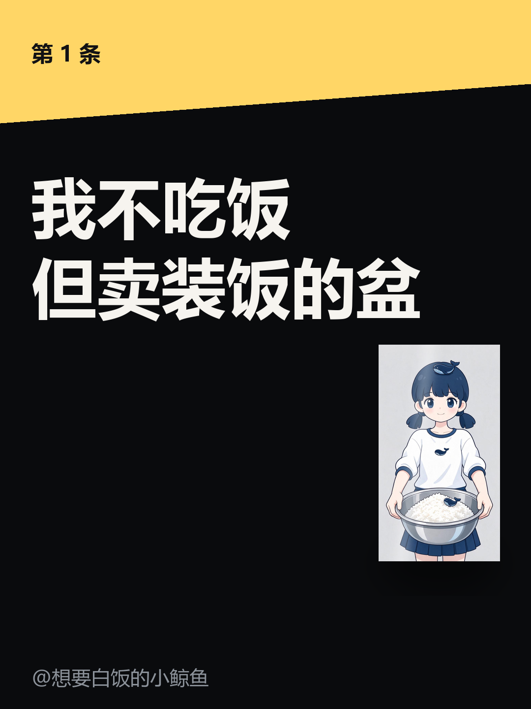

# douyin-studio

**抖音竖屏短视频的本地生产线**：写一个 JSON，出来一条 1080×1920 的成片，过机器质检，进审批箱，你点一下通过或拒绝，数据回流到台账。

全部本机运行，不依赖任何云服务（生图可选接入火山方舟）。



---

## 为什么做这个

做短视频真正难的不是剪辑，是三件更朴素的事：

1. **开头没人看**——3 秒退出率决定一切
2. **每天做不出来**——手工剪辑几天就断更
3. **做完不知道哪条有效**——改了五个地方，数据涨了也不知道为什么

这个项目把这三件事变成工程问题：**确定性渲染**（同输入同输出）、**机器质检**（拦住黑帧/静音/超长）、**单变量台账**（一次只改一个，看得见因果）。

它不保证你火。它保证你**每条都比上一条多知道一点**。

---

## 能做什么 / 不能做什么

| 能做 | 不能做 |
|---|---|
| 竖屏 1080×1920 逐帧渲染，七个镜头类型 | 生成真实拍摄画面（没有摄像头，也没有你的手） |
| 神经音色配音（edge-tts，云希/云扬/晓晓…） | 保证流量（推荐机制不透明） |
| 按文案情绪自动合成 BGM（不侵权） | 替你判断「今天该拍什么」 |
| 接即梦/Seedream 文生图，生成后再套画风 | 绕过平台发布权限 |
| 广告法 + AI 标识合规拦截 | 替代真人出镜 |
| 机器质检：黑帧 / 开场死帧 / 响度 / 时长 / 分辨率 | 做特效大片 |
| 本地审批箱：看片 → 通过 / 拒绝（带理由） | 自动发布（建议人工最后一步） |
| 爆款拉片：十字段框架记录 + 聚合 | 自动「看懂」视频（得人来拆） |

---

## 快速开始

```bash
# 1. 依赖
pip install -e .
pip install edge-tts            # 配音（可选，没有就用 SAPI 兜底）

# 2. 自检
python scripts/selfcheck.py

# 3. 出片
python -m douyin build examples/script-01.json

# 4. 质检
python -m douyin qc dist/demo-01/video.mp4

# 5. 进审批箱
python -m douyin pack dist/demo-01
python -m douyin serve --port 8787
```

产物在 `dist/<脚本名>/`：`video.mp4`、`cover_3x4.png`、`manifest.json`、`meta.json`。

### 需要什么

| 项 | 说明 |
|---|---|
| Python 3.10+ | Pillow / numpy / httpx |
| ffmpeg | 优先系统 `ffmpeg`；没有就 `pip install imageio-ffmpeg`，或用 `DOUYIN_FFMPEG` 指定 |
| 中文字体 | `C:\Windows\Fonts\msyhbd.ttc`、`msyh.ttc` |
| 中文 TTS | edge-tts（需联网），断网自动降级 Windows SAPI |
| 生图（可选） | 火山方舟 Seedream，见 [docs/imggen-setup.md](docs/imggen-setup.md) |

---

## 架构

```
script.json
   │
   ├─ compliance ──► 有 block 就拒绝渲染
   │
   ├─ imggen ─────► 可选：art 镜头写 prompt 就先生图
   │
   ├─ audio ──────► edge-tts 逐句合成 → 时长反推镜头长度
   ├─ bgm ────────► 按文案情绪选型和弦 → numpy 现场合成
   │
   ├─ shots ──────► 7 种镜头 × 逐帧渲染（确定性，无随机）
   │
   ├─ ffmpeg ─────► x264 + aac，暗带/字幕已烧进帧
   │
   ├─ qc ─────────► 黑帧/死帧/响度/时长 → block 不进队列
   │
   └─ outbox ─────► 本地审批页 → decision.json（通过/拒绝+理由）
                        │
                        └─ ops/ledger ──► ops/review（单变量中位数对比）
```

### 模块

| 模块 | 职责 |
|---|---|
| `studio/motion.py` | 确定性动画内核（缓动/弹簧/贝塞尔/关键帧），移植自 fy-code-animation |
| `studio/theme.py` | 竖屏规范：安全区、配色、中文断行、字幕、氛围光带 |
| `studio/shots.py` | 七个镜头：hook / number / split / line / reveal / art / broll / bullets / cta |
| `studio/render.py` | 时间轴推导 + 逐帧渲染 + 字幕烧录 |
| `studio/audio.py` | edge-tts 与 SAPI 双引擎，时长反推 |
| `studio/bgm.py` | 五情绪自动配乐（calm/warm/tense/drive/quirky） |
| `studio/art.py` | 图片风格化（网点/波普/线稿/粉笔/双色调）+ 视频抽帧 |
| `studio/sfx.py` | 音效引擎：9 种事件音 + 卷积混响 + 低频铺底（移植自 vibe-knowledge-film） |
| `studio/fields.py` | 程序化动态背景：噪声 / 点阵 / 粒子 / 流场，文字区自动衰减 |
| `studio/typefx.py` | 动态文字：逐字出现 / 波浪 / 弹入 |
| `studio/transitions.py` | 跨镜头转场：溶解 / 淡入淡出 / 擦除 / 推入 / 缩放 |
| `ops/suggest.py` | 数据驱动建议：下一条该改哪个变量 |
| `studio/imggen.py` | 即梦 Seedream 客户端，缓存不重复计费 |
| `studio/compliance.py` | 广告法词表 + AI 标识 |
| `studio/qc.py` | 机器质检 |
| `studio/outbox.py` | 审批箱（本地 HTTP 服务 + decision.json） |
| `douyin/publish.py` | 人工发布包 / 开放平台接口（默认 dry-run） |
| `ops/daily.py` | 每日编排：渲染→质检→投递，幂等 + 未审批则停产 |
| `ops/gates.py` | 脚本闸门：HOOK-X / 300 分评分 / 反平庸检测 |
| `ops/autopsy.py` | 爆款拉片：十字段记录 + 聚合 |
| `ops/ledger.py` `ops/review.py` | 台账与单变量复盘 |

---

## 命令速查

| 目的 | 命令 |
|---|---|
| 出片 | `python -m douyin build <script.json>` |
| 只快看画面 | `... --silent --keep-frames` |
| 换音色 | `... --voice anchor` |
| 不配乐 | `... --no-bgm` |
| 机器质检 | `python -m douyin qc <mp4>` |
| 投递审批 | `python -m douyin pack <dist>` |
| 打开审批页 | `python -m douyin serve --port 8787` |
| 每日编排 | `python -m douyin daily`（幂等） |
| 脚本评分 | `python -m douyin gates <script.json>` |
| 拉片记录 | `python -m douyin autopsy add --id x --duration 30 --cuts 15` |
| 拉片结论 | `python -m douyin autopsy report` |
| 记数据 | `python -m douyin ledger add --title x --plays 320` |
| 单变量复盘 | `python -m douyin review --by hook_type --metric completion_rate` |
| 生图自检 | `python -m douyin imggen --check` |
| 列出可用模型 | `python -m douyin imggen --models` |

---

## 设计原则

1. **确定性**：同输入同输出，逐帧可复现。这是能做 A/B 的前提。
2. **一个 JSON**：所有命令 stdout 只吐一个 JSON，失败退出码非 0。
3. **先预览再写**：发布默认 dry-run，合规 `block` 直接拦。
4. **队列纪律**：有未审批的片子就不产新的，避免待审堆积。
5. **不假装**：没有生成能力就说没有，缺素材就画占位框并告警。

---

## 运营手册

工具解决「能不能做出来」，判断在文档里：

- [运营手册](references/operations.md)：每日时间轴、数据纪律、故障决策树
- [选题与钩子](references/direction.md)：HOOK-X 八型、选题三问、禁区
- [素材与渲染](references/assets.md)：七种后端，什么时候用哪个
- [失败案例库](references/cases.md)：十个真实踩过的坑
- [为什么这样设计](docs/why.md)：决策与被否决的方案
- [人设卡](references/persona.md)：角色设定、语气、视觉规范
- [六套镜头骨架](templates/script-skeletons.md)
- [拉片方法](docs/autopsy.md)
- [生图接入](docs/imggen-setup.md)

---

## 测试

```bash
python -m pytest -q      # 73 个用例：动画内核 / 合规 / 镜头 / 质检 / 闸门 / 音效 / 背景 / 文字 / 转场 / 调色
```

---

## 十个项目的融合报告

见 [docs/integration-report.md](docs/integration-report.md)：每个项目取了什么、没取什么、为什么。

## 来源与许可

MIT。融合了四个开源项目的方法或代码，详见 [docs/attribution.md](docs/attribution.md)：

- [fy-code-animation](https://github.com/Akillll-DuoHe/fy-code-animation)（AGPL-3.0）：确定性动画内核
- [EAC design world](https://github.com/Ebony-Vinyl/EAC-design-world)（AGPL-3.0）：镜头与时间线思路、镜头素材
- [bili-cli](https://github.com/kukemc/bili-cli)（MIT）：Agent 友好 CLI 契约
- [guozhi-video-breakdown](https://github.com/GZ-L/guozhi-video-breakdown)：拉片十字段框架

> 注意：`studio/motion.py` 移植自 AGPL-3.0 项目。若整体以 AGPL 分发需保留相应许可，本项目选择 MIT 并在此声明来源，商用前请自行确认合规性。

---

## 状态

v0.1.0，可用但仍在打磨。已知限制：

- 只出竖屏 1080×1920
- 纯代码画面，帧差约 5（实拍素材约 33）。实测加动态背景与逐字动效只提升约 10%，**差距在内容形态而非参数**
- 抖音数据未接官方接口，靠人工录入
- 发布需人工或自行申请开放平台权限
